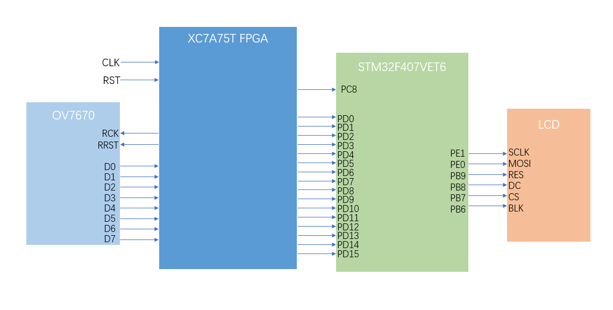

# Edge_Detection_Accelerator
简介：基于 AMD Artix-7 FPGA 与 STM32软硬协同的实时图像边缘检测硬件加速器。FPGA 实现全流水线 Sobel 算子与自定义并行总线，STM32 负责控制与显示。VHDL/C.  

复现步骤：  
project_package中的STM32F407项目可以直接下载下来用keil5打开工程，有STM32F407VET6的话直接烧录代码即可
由于FPGA的工程项目太大，这里就没有把整个工程添加进来了，在vivado中重新创建项目把.vhd和.xdc文件复制进去即可，生成比特流文件后烧录到板子上，这里用的是Xilinx的XC7A75FGG484-2，FPGA板子的引脚需要结合.xdc文件和引脚分配文档来连接.  
  
电路连接图如下：  
  

这里使用的硬件为带FIFO的OV7670、XC7A75T FPGA、STM32F407VET6、240*240的TFT显示屏  

OV7670与stm32f407的其他引脚连接：  
SIOC--PB5&nbsp;&nbsp;&nbsp;&nbsp;SIOD--PB4  
VSY--PB3&nbsp;&nbsp;&nbsp;&nbsp;OE--PA8  
WR--PA11&nbsp;&nbsp;&nbsp;&nbsp;WRST--PA10  
RCK--PA12&nbsp;&nbsp;&nbsp;&nbsp;RRST--PA9  
RESET--PC11&nbsp;&nbsp;&nbsp;&nbsp;PWDN--PC10
